# Shots, stints and schedules

Basketball analytics from public data, by Joseph Smarrelli. Two bodies of work
live here. The first is a set of studies of San Antonio's 2025-26 season, built
the way a coaching staff would use them: a question, a clean comparison, an
honest interval and what to take into the film room. The second is
twelve longer studies across twenty-two seasons of shot charts and play-by-play,
each aimed at an argument people are still having.

Everything runs from raw public files, every number quoted is committed as a
table next to the write-up, and every study says what its data cannot see.

---

## The 2025-26 season

### The 12 seconds after a Spurs turnover

[Read the write-up &rarr;](https://jmsmarrelli.github.io/spurs-game-management/reports/01_turnover_cost.html) &middot; [`spurs-game-management` on GitHub](https://github.com/jmsmarrelli/spurs-game-management)

A turnover count treats a stolen pass and a shot-clock violation the same. They
are not. Opponents scored 0.69 more points in the next 12 seconds after
San Antonio turnovers linked to a steal, adjusted within games, interval +0.58 to
+0.79. The same repository has a matched study of timeouts, which finds that
both groups recover from a scoring dip and a timeout does not measurably speed
it up, and a study of the last 40 seconds of a quarter.

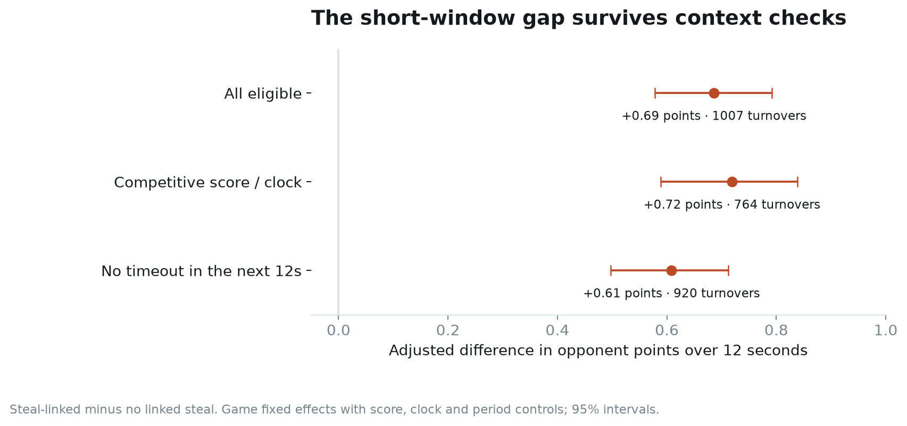

### Where Wembanyama changes the shot map

[Read the write-up &rarr;](https://jmsmarrelli.github.io/spurs-research/reports/01_wembanyama_rim_footprint.html) &middot; [`spurs-research` on GitHub](https://github.com/jmsmarrelli/spurs-research)

Rotations rebuilt from substitution logs, compared within the same games:
opponents' share of shots at the rim is 4.6 points lower during his minutes,
interval −7.0 to −2.3. Whether they also finish worse at the rim is much less
certain. The same repository takes on the Fox–Castle–Harper groups and his
playoff shot diet.

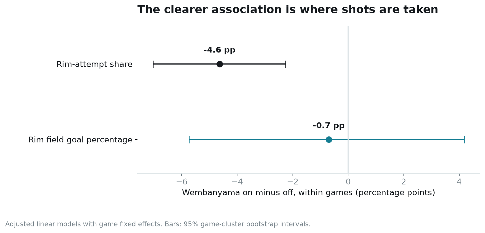

### The part of SGA's offense a shot chart misses

[Read the write-up &rarr;](https://jmsmarrelli.github.io/west-playoff-scouting/reports/01_sga_foul_channel.html) &middot; [`west-playoff-scouting` on GitHub](https://github.com/jmsmarrelli/west-playoff-scouting)

Free throws supplied 24.6% of Shai Gilgeous-Alexander's retained points, and
16.2% of his scoring chances ended in a foul trip with no shot attempt at all. A
field-goal scouting report leaves out a quarter of the player. Alongside it: the
shots Oklahoma City allows against a model reference, and a rebounding study of
the Western contenders.

### The first quarter and the rest of the Finals

[Read the write-up &rarr;](https://jmsmarrelli.github.io/nba-analytics-portfolio/reports/08_finals_postmortem_R.html) &middot; [`nba-analytics-portfolio` on GitHub](https://github.com/jmsmarrelli/nba-analytics-portfolio)

San Antonio won the first quarter of the 2026 Finals by 57 points over five
games and lost the series by 12. Part of a set of eight studies that includes a
lineup reconstruction audit, a rotation optimizer that loses to the allocation it
replaces, and a season baseline for 2026-27, three of them written in R.

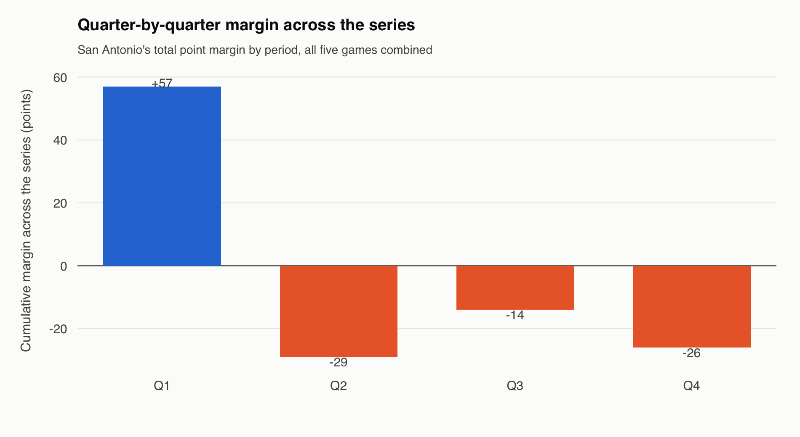

**Also from 2025-26:** [opponent scouting sheets](https://jmsmarrelli.github.io/nba-opponent-scouting/)
for Oklahoma City, Denver and Houston, and [three league-wide studies](https://jmsmarrelli.github.io/basketball-research/)
on second shots, three-point defense and when to update a shooter.

---

## Twenty-two seasons: league-wide

Twelve studies, 2003-04 to 2024-25. **4.4 million shot attempts · 2.15 million
possessions rebuilt from substitution logs · 26,453 games.** Four of the twelve
end in a null, and say so.

### Shot quality and shot making

[Read the write-up &rarr;](https://jmsmarrelli.github.io/nba-shot-value/) &middot; [`nba-shot-value` on GitHub](https://github.com/jmsmarrelli/nba-shot-value)

The three-point revolution gets credit for the league's efficiency boom. It is
worth a little over a third of it: three-point accuracy went from .354 to .363 in
twenty-two seasons, essentially nowhere, while the two-pointer went from .460 to
.545. An expected-points model scored out of fold splits any set of attempts into
the shots you generated and the shots you made — two skills that turn out to be
almost unrelated and to stabilize at wildly different speeds.

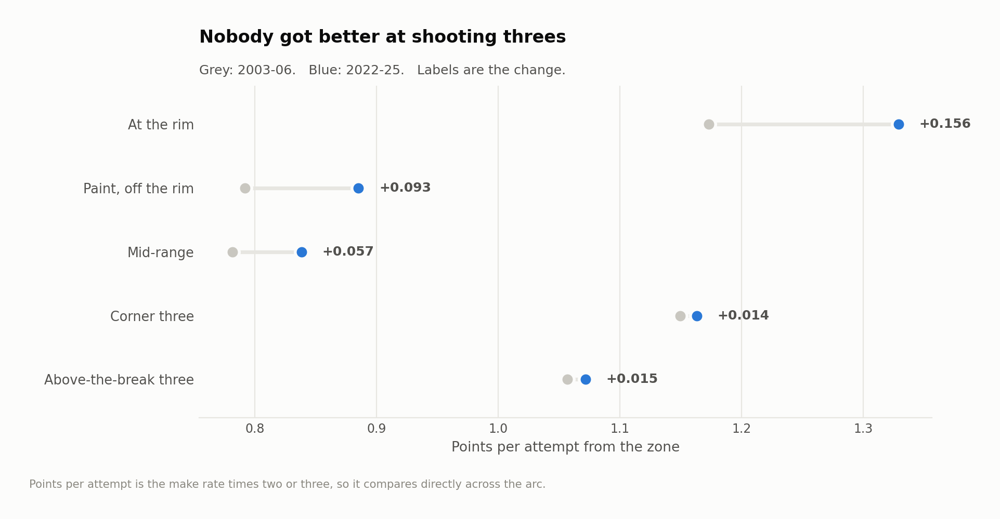

### RAPM, built from the log up

[Read the write-up &rarr;](https://jmsmarrelli.github.io/nba-rapm/) &middot; [`nba-rapm` on GitHub](https://github.com/jmsmarrelli/nba-rapm)

Play-by-play records substitutions and never records a lineup. Rebuilding the ten
players on the floor for 11,145 games — and proving it, with 99.5% of
player-games landing within a minute of the box score — is most of the work. Run
without regularization, adjusted plus-minus is worse on held-out games than a
model that knows only the two team names.

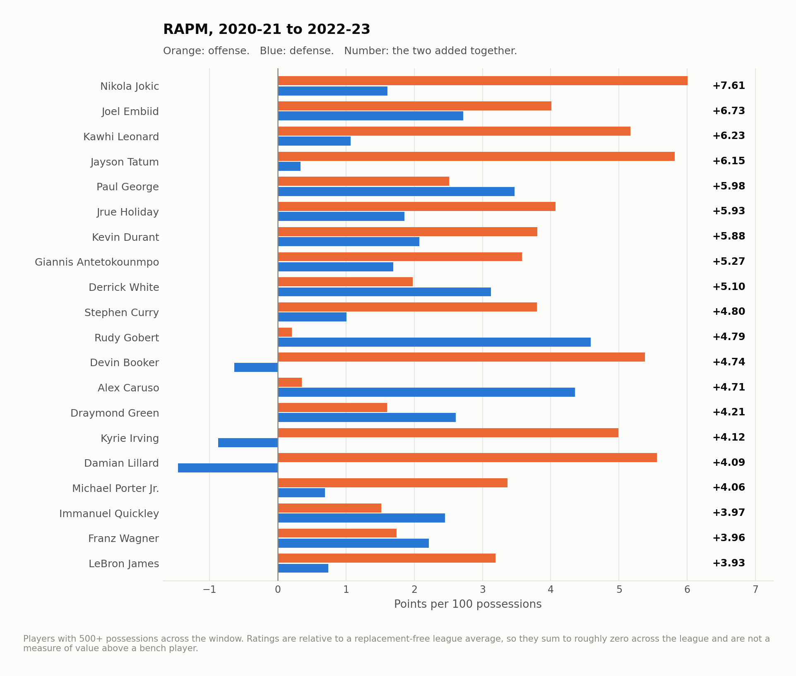

### The schedule tax

[Read the write-up &rarr;](https://jmsmarrelli.github.io/nba-schedule-tax/) &middot; [`nba-schedule-tax` on GitHub](https://github.com/jmsmarrelli/nba-schedule-tax)

Twenty seasons of rest, travel and time zones priced inside a fixed-effects
model. A season's worth of schedule luck is about a quarter of a win. Playing at
altitude is worth ten times that, every year, to the same two teams. Miles flown
never reach significance; time zones crossed do.

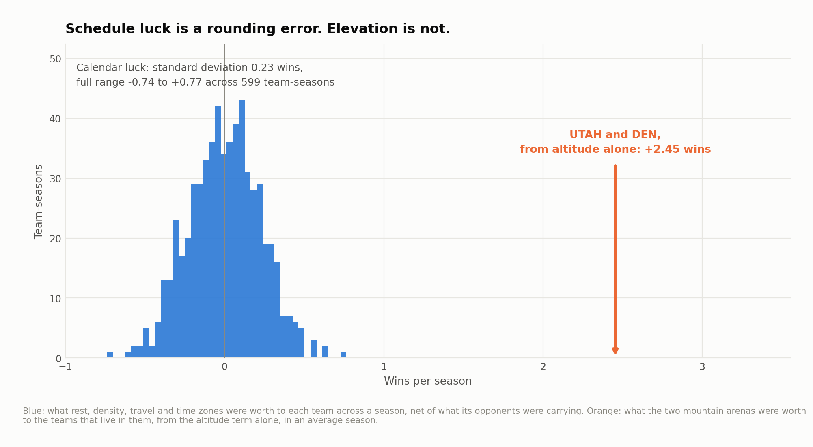

---

## Twenty-two seasons: San Antonio

### What Wembanyama actually changes

[Read the write-up &rarr;](https://jmsmarrelli.github.io/spurs-rim-deterrence/) &middot; [`spurs-rim-deterrence` on GitHub](https://github.com/jmsmarrelli/spurs-rim-deterrence)

The most repeated claim about him is that opponents stop going to the rim when he
plays. At game level, the only split this data allows for his first two seasons,
opponent rim share barely moves — a design too blunt to settle it either way.
What does move, and survives a correction for testing twelve measures at once, is
where opponents shoot outside the paint: more mid-range, fewer corner threes.

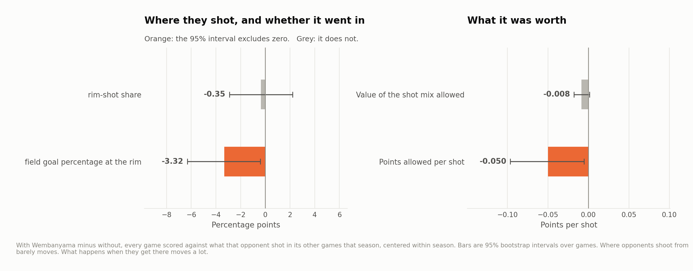

### Did the Spurs invent modern shot selection?

[Read the write-up &rarr;](https://jmsmarrelli.github.io/spurs-shot-selection/) &middot; [`spurs-shot-selection` on GitHub](https://github.com/jmsmarrelli/spurs-shot-selection)

Across twenty-two seasons their shot chart sits 0.13 years *behind* the league's
own trajectory, 16th of 34 teams. Houston is +5.75. The average conceals two
eras that could not be less alike.

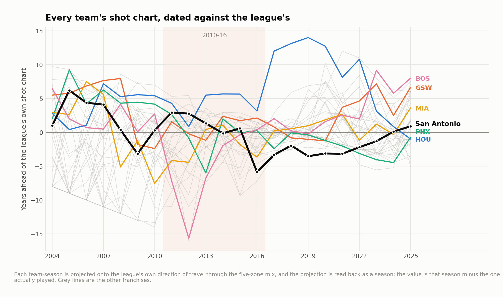

### The Rodeo Road Trip

[Read the write-up &rarr;](https://jmsmarrelli.github.io/spurs-rodeo-trip/) &middot; [`spurs-rodeo-trip` on GitHub](https://github.com/jmsmarrelli/spurs-rodeo-trip)

They win more on it. They do not play better on it. Both of those are true, and
the gap between them is the schedule — the trip is disproportionately made of
games against teams having a bad season.

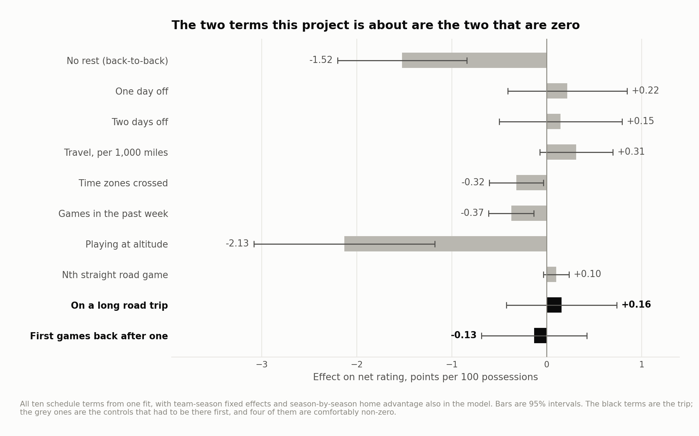

### The Beautiful Game, measured

[Read the write-up &rarr;](https://jmsmarrelli.github.io/spurs-passing/) &middot; [`spurs-passing` on GitHub](https://github.com/jmsmarrelli/spurs-passing)

The volume claim is ordinary. The distribution claim is extraordinary — but only
once you account for the fact that bad teams look generous for free.

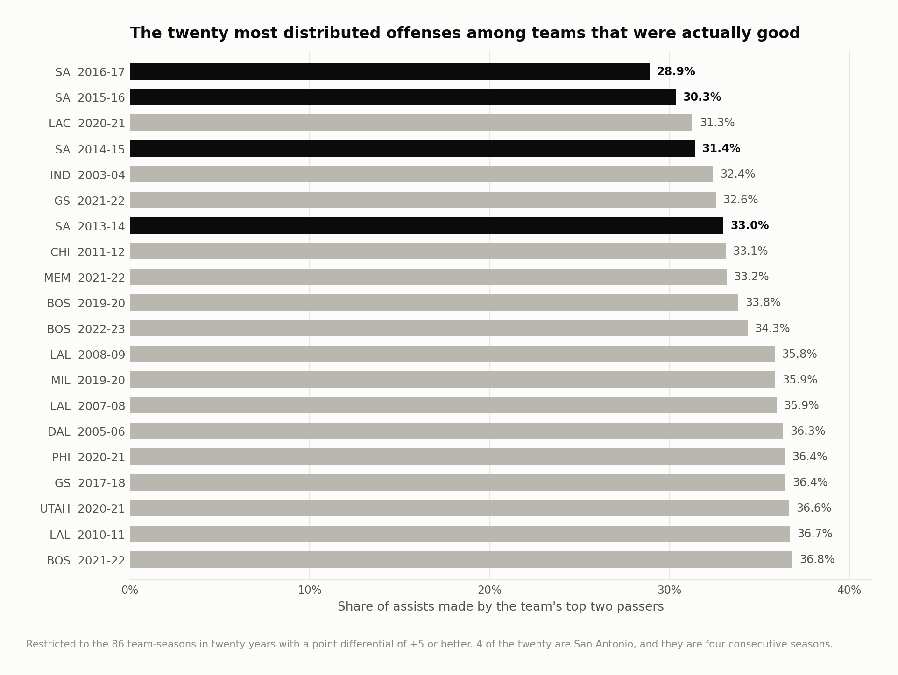

### What resting the Big Three actually bought

[Read the write-up &rarr;](https://jmsmarrelli.github.io/spurs-rest-policy/) &middot; [`spurs-rest-policy` on GitHub](https://github.com/jmsmarrelli/spurs-rest-policy)

The reputation is real, and it starts later than the story says — after the 2005
and 2007 titles, not before them.
What it cost is measurable. What it bought is not.

### Tim Duncan's defense, and whether there was a Spurs defense

[Read the write-up &rarr;](https://jmsmarrelli.github.io/spurs-duncan-rapm/) &middot; [`spurs-duncan-rapm` on GitHub](https://github.com/jmsmarrelli/spurs-duncan-rapm)

Among players who were on the floor for a career's worth of the era, only Kevin
Garnett rates higher on defense than Tim Duncan. There is no measurable Spurs
defense on top of the Spurs defenders — and the two franchises where there is one
are Chicago and Indiana.

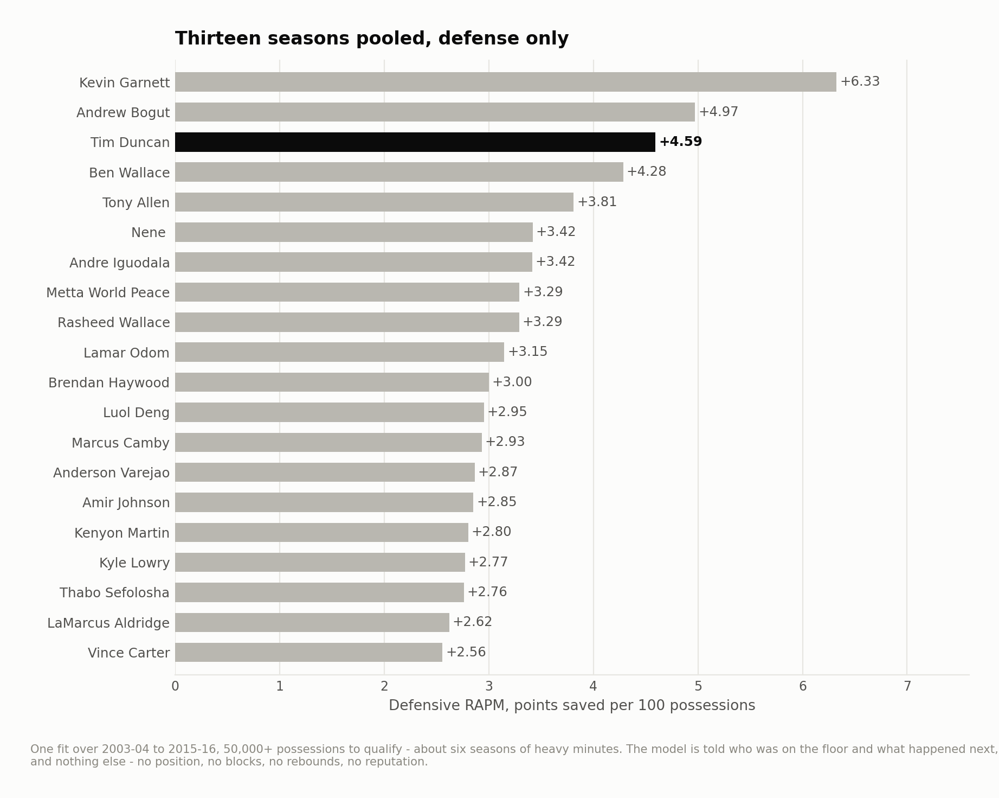

---

## Twenty-two seasons: the Western field

### The best defense a shot chart has ever seen

[Read the write-up &rarr;](https://jmsmarrelli.github.io/okc-defence/) &middot; [`okc-defence` on GitHub](https://github.com/jmsmarrelli/okc-defence)

Oklahoma City's 2024-25 defense took more points off the board per game than any
of the 659 team-seasons since 2003-04. It is not the best shot defense in the
sample, and about half of its conversion edge sits on opponent three-point
percentage, which repeats year to year at 0.19.

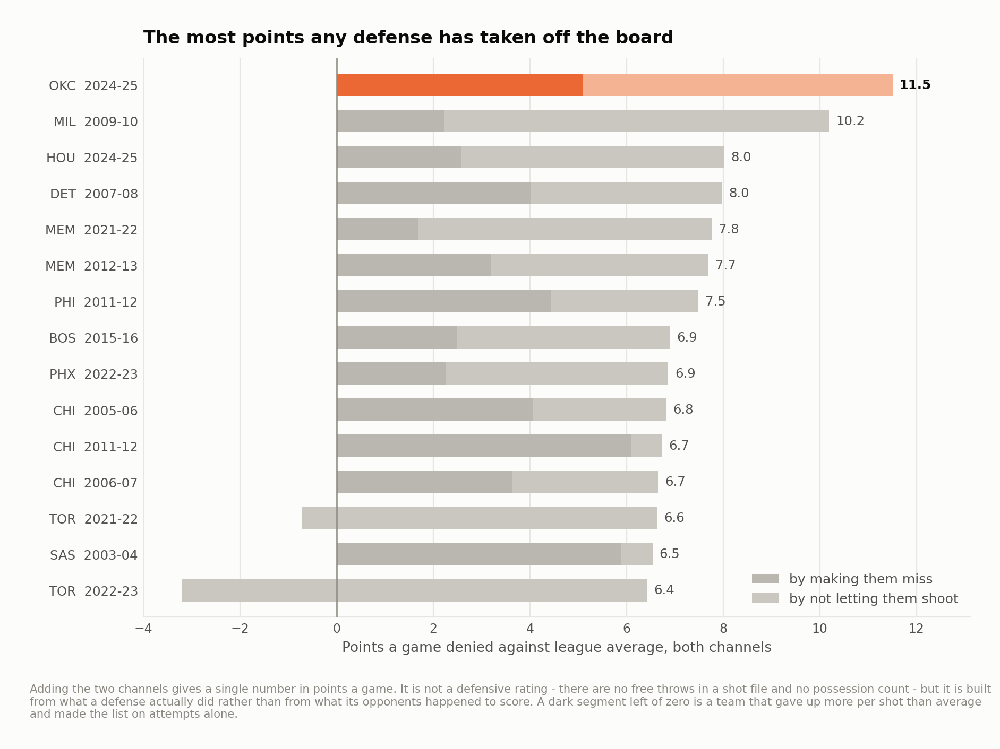

### A matchup atlas for the Western top tier

[Read the write-up &rarr;](https://jmsmarrelli.github.io/west-shot-matchups/) &middot; [`west-shot-matchups` on GitHub](https://github.com/jmsmarrelli/west-shot-matchups)

A shot chart is half chosen and half imposed, the two halves add, and there is no
matchup effect on top of them: across 17,775 pairings the interaction term moves
R² by six ten-thousandths. Removing the leak in the obvious version of that
regression is worth four points of R², which is more than anything else tested.

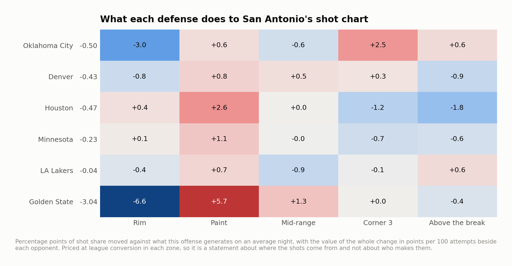

### The half of a contender you can scout in a week

[Read the write-up &rarr;](https://jmsmarrelli.github.io/contender-shot-quality/) &middot; [`contender-shot-quality` on GitHub](https://github.com/jmsmarrelli/contender-shot-quality)

Shot quality repeats at 0.84 across two 622-shot samples of the same team. Shot
making repeats at 0.38. A seven-game series is 622 shots. Over a full season,
though, shot making is the *more* persistent of the two once you correct for how
precisely each is measured — which is the opposite of what I expected to find.

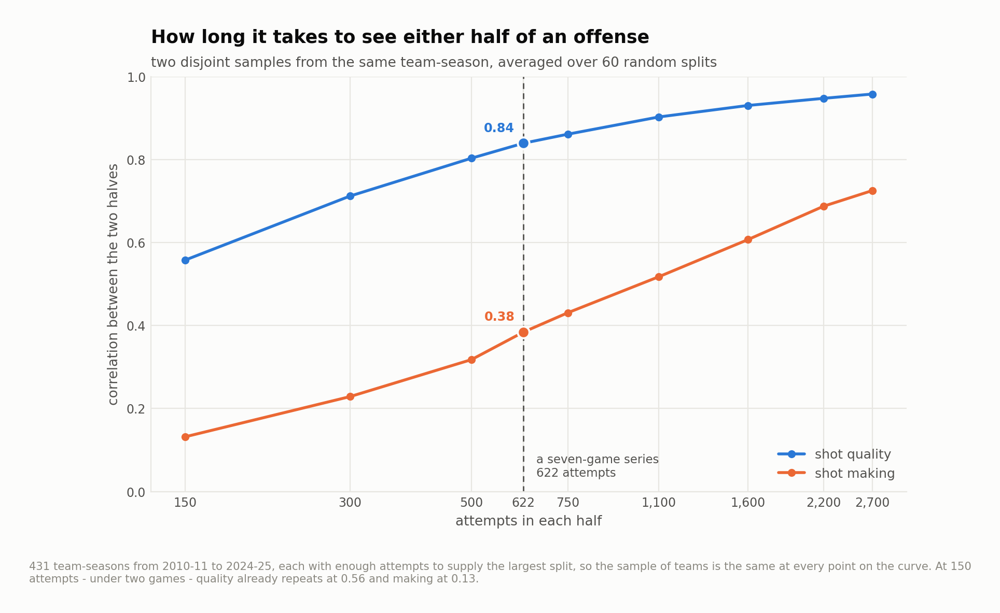

---

## Data work

Three defects in the public record, each found while building something else and
each large enough to change a headline:

- **The action-type vocabulary was rewritten mid-sample.** "Pull-up jump shot"
  and "floating jump shot" do not exist in the 2003-04 file; they appear between
  2007 and 2009 and now cover 28% of attempts, while the plain "layup" they were
  carved out of collapses from 16.2% to 1.6%. A second, smaller rewrite lands
  between 2014-15 and 2015-16. A model handed that feature reports the scorer's
  table as a change in basketball.
- **Shot coordinates were recorded differently before 2010-11.** A quarter of all
  attempts in those seasons sit at exactly zero feet, because most rim attempts
  were logged at the rim's own coordinate. Afterwards it is 5%.
- **Three season files are published on a different coordinate scale entirely.**
  Detected, inverted, and cross-checked against the files' own distance column,
  which then agrees to within half a foot in every season.

## Sources and tools

The NBA's public shot chart endpoint, mirrored at
[DomSamangy/NBA_Shots_04_24](https://github.com/DomSamangy/NBA_Shots_04_24);
ESPN's play-by-play and box score feeds via
[hoopR-data](https://github.com/sportsdataverse/hoopR-data); and, for 2025-26,
NBA play-by-play and shot records from a pinned revision of
[shufinskiy/nba_data](https://github.com/shufinskiy/nba_data). Python for almost
everything (pandas, scikit-learn, scipy, matplotlib), R for three of the 2025-26
studies, and SQL where a query is the clearest way to show the work. No
proprietary or tracking data is used anywhere.

## License

MIT. See `LICENSE`.
