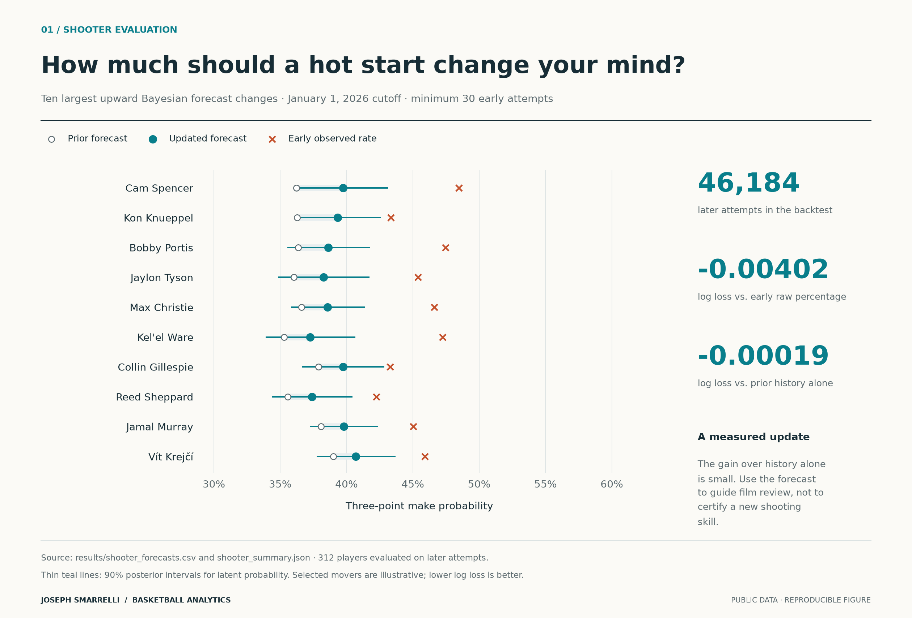
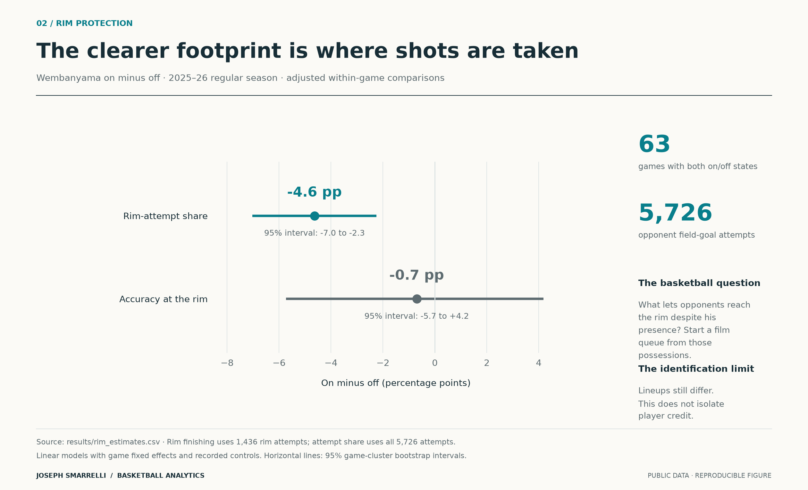
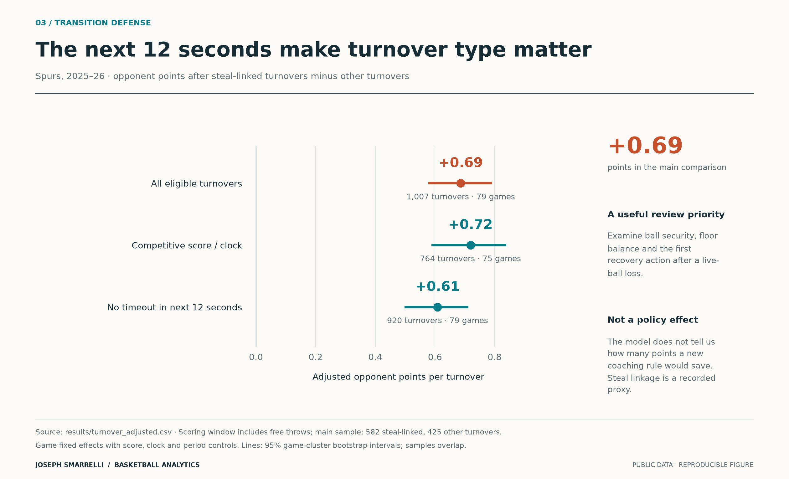
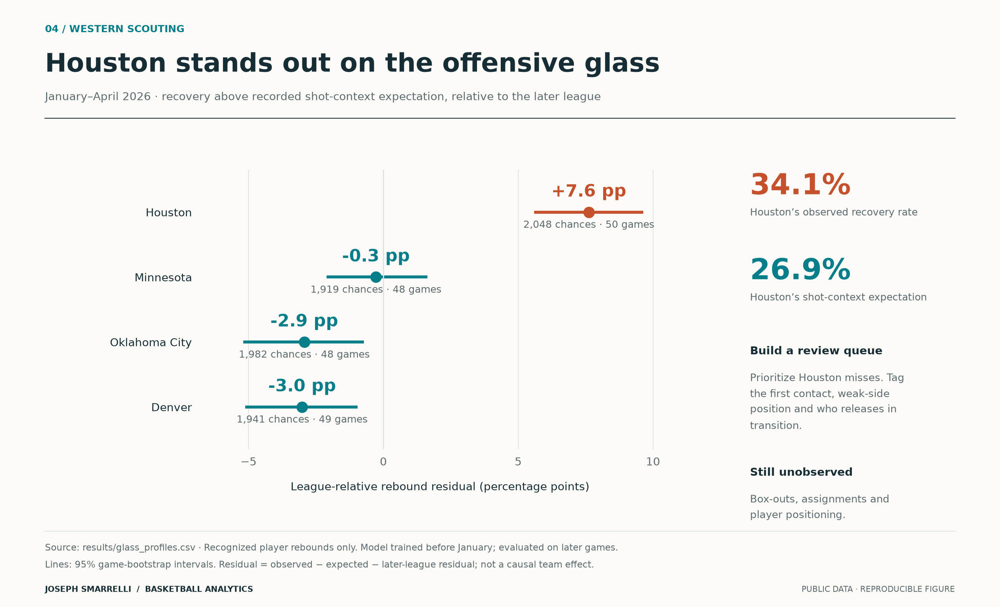
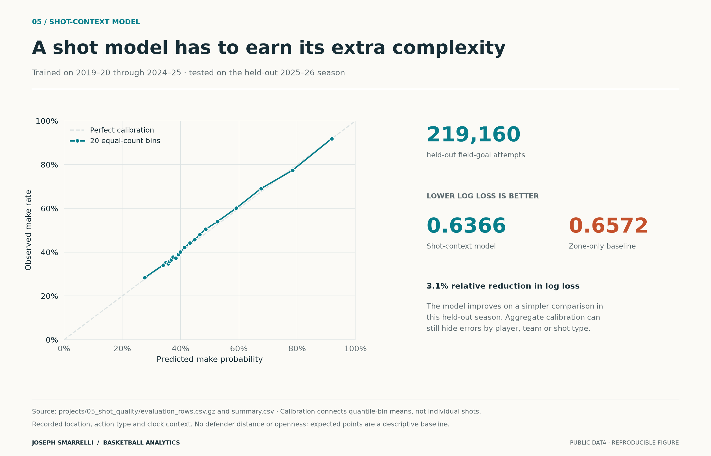

# Basketball decisions from public data

Joseph Smarrelli · Python, R and SQL · Basketball analytics portfolio

A useful analysis changes the next question a basketball staff asks. These five studies connect a specific basketball problem to a measured comparison, an uncertainty estimate and a practical next step. They do not claim professional-team deployment.

[Decision briefs](docs/decision_briefs.md) · [Visual standards](docs/visual_standards.md) · [Validation](VALIDATION_CURRENT.md) · [Authorship and AI assistance](PROVENANCE.md)

## Start here

### When should a hot start change the scout?

*01 / Forecasting*

Bayesian updates beat an early raw percentage. The gain over prior history alone is much smaller: 0.00019 in held-out log loss.

**Empirical Bayes · chronological validation · calibrated uncertainty**

[Read the study](https://github.com/jmsmarrelli/basketball-research/blob/main/reports/03_when_to_update_a_shooter.md) · [Decision brief](https://github.com/jmsmarrelli/basketball-research/blob/main/reports/00_decision_brief.md)

### Rim access and rim finishing are different questions

*02 / Rim protection*

Adjusted opponent rim-attempt share is 4.6 percentage points lower during Wembanyama's minutes across 63 games. The finishing comparison is less precise.

**Lineup reconstruction · within-game comparisons · cluster bootstrap**

[Read the study](https://github.com/jmsmarrelli/spurs-research/blob/main/reports/01_wembanyama_rim_footprint.md) · [Decision brief](https://github.com/jmsmarrelli/spurs-research/blob/main/reports/00_decision_brief.md)

### The 12 seconds after a turnover

*03 / Coaching decisions*

Steal-linked turnovers precede 0.69 more opponent points over 12 seconds after recorded-context adjustment. That identifies a review priority, not a coaching policy effect.

**Event sequencing · fixed effects · sensitivity analysis**

[Read the study](https://github.com/jmsmarrelli/spurs-game-management/blob/main/reports/01_turnover_cost.md) · [Decision brief](https://github.com/jmsmarrelli/spurs-game-management/blob/main/reports/00_decision_brief.md)

### Houston changes the rebounding question

*04 / Opponent scouting*

Houston's offensive-rebound residual is 7.6 percentage points above the later league after recorded shot-context adjustment. Positioning and box-outs remain unobserved.

**Chronological modeling · contextual baselines · scouting interpretation**

[Read the study](https://github.com/jmsmarrelli/west-playoff-scouting/blob/main/reports/03_western_glass.md) · [Decision brief](https://github.com/jmsmarrelli/west-playoff-scouting/blob/main/reports/00_decision_brief.md)

### A shot model has to beat the simple alternative

*05 / Predictive modeling*

The recorded-context model improves held-out log loss from 0.6572 to 0.6366 on 219,160 attempts. It does not observe openness or defender distance.

**Gradient boosting · held-out calibration · baseline comparison**

[Read the study](https://github.com/jmsmarrelli/nba-analytics-portfolio/blob/main/reports/05_shot_quality.md) · [Decision brief](https://github.com/jmsmarrelli/nba-analytics-portfolio/blob/main/reports/00_decision_brief.md)

## Browse the repositories

| Repository | Contents | Suggested role |
|---|---|---|
| [basketball-research](https://github.com/jmsmarrelli/basketball-research) | Second shots, three-point defense and Bayesian shooter updates | Featured research |
| [spurs-research](https://github.com/jmsmarrelli/spurs-research) | Within-game rim footprint, guard groups and playoff shot diet | Featured research |
| [spurs-game-management](https://github.com/jmsmarrelli/spurs-game-management) | Turnover timing, matched timeouts and quarter-clock choices | Featured coaching questions |
| [west-playoff-scouting](https://github.com/jmsmarrelli/west-playoff-scouting) | Free-throw scoring, OKC shot context and offensive rebounding | Featured scouting |
| [nba-analytics-portfolio](https://github.com/jmsmarrelli/nba-analytics-portfolio) | Eight studies in Python and R, including a lineup audit and an optimizer that underperforms its comparison | Featured methods; lead with the shot model |
| [nba-opponent-scouting](https://github.com/jmsmarrelli/nba-opponent-scouting) | One-page OKC, Denver and Houston scouting sheets | Supporting communication example |
| [nba-rapm](https://github.com/jmsmarrelli/nba-rapm) | Reconstruct lineups and fit regularized impact models | Methods appendix; carryover forecast does not beat prior team strength |
| [spurs-duncan-rapm](https://github.com/jmsmarrelli/spurs-duncan-rapm) | Historical defensive estimates and team residuals | Historical model study |
| [nba-shot-value](https://github.com/jmsmarrelli/nba-shot-value) | Location, conversion and changes in recording conventions | Historical shot study |
| [contender-shot-quality](https://github.com/jmsmarrelli/contender-shot-quality) | Sampling reliability of location and conversion | Supporting uncertainty study |
| [west-shot-matchups](https://github.com/jmsmarrelli/west-shot-matchups) | Team shot profiles and leave-pairing-out comparisons | Historical matchup study |
| [okc-defence](https://github.com/jmsmarrelli/okc-defence) | Field-goal offense/defense decomposition | Historical study; net edge is not defense alone |
| [nba-schedule-tax](https://github.com/jmsmarrelli/nba-schedule-tax) | Rest, travel and schedule associations | Exploratory; fixed effects do not identify causal altitude effects |
| [spurs-rim-deterrence](https://github.com/jmsmarrelli/spurs-rim-deterrence) | Whole-game availability and shot geography | Earlier coarse comparison; separate from within-game work |
| [spurs-shot-selection](https://github.com/jmsmarrelli/spurs-shot-selection) | Spurs shot-location history | Historical descriptive context |
| [spurs-rodeo-trip](https://github.com/jmsmarrelli/spurs-rodeo-trip) | Road-trip outcomes, opponents and close-game definitions | Historical descriptive context |
| [spurs-passing](https://github.com/jmsmarrelli/spurs-passing) | Assist volume and distribution | Historical descriptive context |
| [spurs-rest-policy](https://github.com/jmsmarrelli/spurs-rest-policy) | Recorded absences and team results | Descriptive; absence is not proof of planned rest |

The additional seven-project **The Next Possession** collection is under local review. Its schedule tools and cross-language work are useful supporting examples. Its co-appearance scores and neutral tournament remain demonstrations, so they are not included among the featured research. It has no published repository in this release.

## Evidence and authorship

Current checks and their limits are in [VALIDATION_CURRENT.md](VALIDATION_CURRENT.md). Each repository distinguishes original artifacts, previously prepared repairs and changes made during the October review. [PROVENANCE.md](PROVENANCE.md) records AI assistance. Passing unit tests or reproducing a result from derived rows does not independently verify the original source feed.

The existing source archives are public, pinned and attributed where available. Some full rebuilds require omitted raw downloads and a Python 3.12 environment. New code is MIT licensed; underlying NBA, ESPN and third-party data retain their own rights and terms. No proprietary team data or completed film review is implied.

To rebuild this navigation page: `python -m pip install -r requirements.txt`, then `python tools/site.py`. Feature branches and pull requests are authorized; default-branch merges require owner approval. Remote updates require a working connection; current execution status is recorded in the validation notes.
